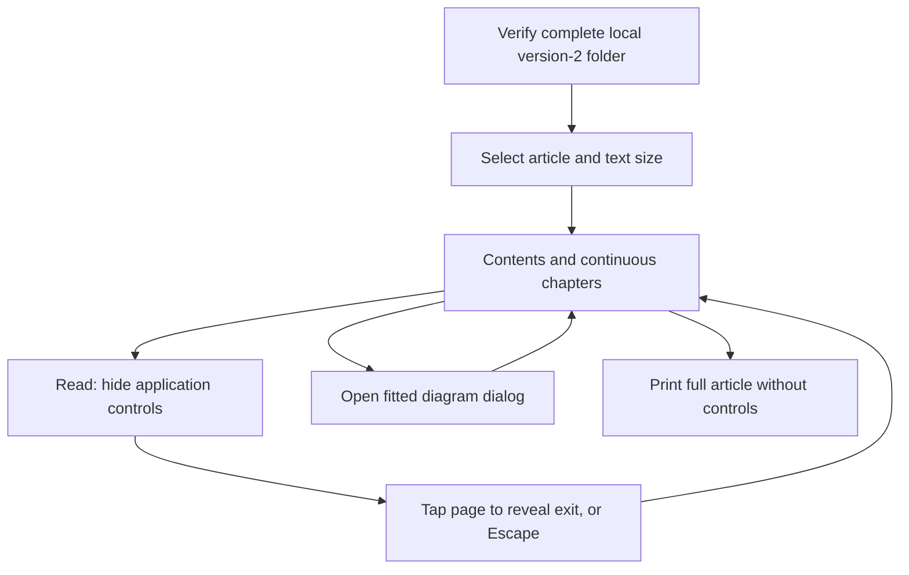

# Continuous reading behavior

Implements [requirements](/0002-article-requirements.md) and the
[article decision](/0003-article-decision.md), replacing [thread navigation](/reading-behavior.md).

<!-- mermaid-diagram: article-reading -->

<!-- /mermaid-diagram: article-reading -->

## Scenarios

1. Given an imported article, when opened, show all authored chapters, historical
   sections, code excerpts and diagrams in order. Markup stays literal.
2. Given Read mode, when entered, hide application controls without moving the
   reading position. A tap reveals Show controls; Escape exits. Diagrams still open.
3. Given an expanded diagram, when the viewport changes, select and fit the most
   legible supplied orientation. Closing returns to the same article position.
4. Given printing, when print media is applied, show the entire article and fitted
   print diagrams without application or dialog controls. Code wraps rather than clips.
5. Given a chapter end, when visible, persist its read marker. Manual unread
   suppresses automatic marking until the article is reopened.
6. Given cached application and article, when offline, reopen all narrative and excerpts.
7. Given an old version or diagram/viewport mismatch, when imported, reject before storage.

## Test design

| Case | Level | Assertion and purpose |
|---|---|---|
| Ordered article and malicious text | Browser integration | All content and literal excerpts appear without execution or external requests |
| Read, touch exit and keyboard | Browser integration | Controls hide, position remains and focus can exit |
| Fitted dialog and rotation | Browser integration | Correct asset and complete image fit without zoom |
| Print | Browser integration and PDF smoke | Full prose/code/figures print without clipping or controls |
| Progress and offline | Browser integration | New generation isolation and usable cached article |
| Invalid version/viewport | Browser import integration | Invalid replacement cannot change cached article |

Acceptance: Chromium and supported-runner WebKit pass; pending physical iPad and
printer checks are reported explicitly rather than inferred from desktop automation.

## Verification, 2026-10-19

Local Chromium passes 23 browser scenarios. The generated synthetic English
article was inspected in portrait, landscape and A4 PDF output. A derived stress
fixture with 10 chapters, 70 excerpts and 10 diagrams had no horizontal overflow
at 390 CSS pixels; its 112-page PDF had no text outside page bounds. These are
synthetic checks, not a real private-PR generation or physical printer test.

Local WebKit cannot launch on Ubuntu 25.04 because required libraries, including
`libicu74`, are unavailable. Supported-runner CI remains the WebKit merge gate.

Review regressions reproduce wheel-driven background movement and dark-theme
page margins. Wheel tests use desktop input because Playwright cannot synthesize
wheel events in mobile WebKit. A native DevTools touch-swipe check in Chromium
mobile emulation preserves the article position and verifies disposal unlocks it.
Dark-theme A4 PDFs with the dialog open and closed retain identical full text;
all 14 pages have white margin samples after the print-specific color-scheme fix.
