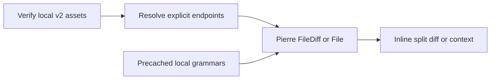
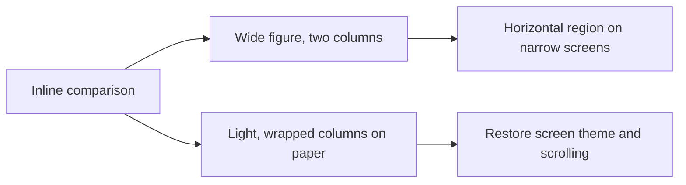

# Comparison reading

Implements [requirements](/0006-split-diff-requirements.md) using the
[library decision](/0007-split-diff-decision.md).

1. Given a diff block, show both revisions inline, with revision/path captions.
2. Given added, deleted or existing empty files, retain the declared missing side.
3. Given Python context, render the authored range with actual file line numbers.
4. Given markup inside code, show literal source without execution or upload.
5. Given an offline reload, reopen comparisons using local source and syntax assets.

| Scenario | Level | Purpose |
|---|---|---|
| 1, 2, 4, 5 | Browser integration | Actual library rendering, safety and offline loading |
| 3 | Existing range browser integration | Context remains bounded after replacing pre rendering |

Acceptance: Chromium and supported-runner WebKit. Wide/narrow/print geometry is
the next implementation slice, not a claimed physical-device result.

## Amendment, 2026-10-22: exact Git line boundaries

Given source containing a lone carriage return, when displaying it, retain Git's
LF-delimited line numbers. Show an explicit control-escaped-source notice and
JSON-escape each LF-delimited line without enclosing quotes. Both diff endpoints
use the same reversible display encoding; their stored checksummed bytes remain
unchanged. This avoids a library convention that otherwise treats CR as a line
boundary. The browser regression verifies that reference `2-2` of `a\rb\nc\n`
displays `c`, not `b`.

## Amendment, 2026-10-22: screen and paper geometry

1. Given a wide screen, when reading a comparison, use the available width beyond
   the prose column. Identify the before and after revision above their columns.
2. Given a narrow screen or rotation, keep two readable columns in a focusable,
   horizontally scrollable region. Preserve Python whitespace without making the
   article itself scroll horizontally. Single-file context scrolls independently.
3. Given printing, wrap long lines within the paper width, use the light theme
   even from dark mode and allow code to paginate. Hide interactive expansion
   controls, then restore the screen display when printing ends.

| Case | Level | Proves |
|---|---|---|
| Wide to narrow rotation | Browser integration | Horizontal column alignment, accessible local scrolling and no page overflow |
| Long Python comparison in print media | Browser integration | All changes remain present without clipped lines, with screen layout restored afterward |

Acceptance: both browser projects pass. Browser print-media checks do not claim
physical iPad or printer verification.

Actual printing also prepares wrapped rendering synchronously in `beforeprint`
and restores it in `afterprint`; print-media notifications alone can arrive after
pagination begins. The Chromium PDF-path regression checks preparation before
pagination, and a local extracted-PDF check verifies the final line and footer.
Revision captions share the same scrolling surface as their source columns.
