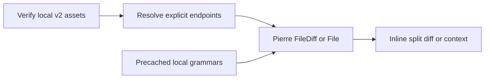

# Comparison reading

Implements [requirements](/0006-split-diff-requirements.md) using the
[library decision](/0007-split-diff-decision.md).

1. Given a diff block, show both revisions inline, with revision/path captions.
2. Given added, deleted or existing empty files, retain the declared missing side.
3. Given Python context, render the authored range with actual file line numbers.
4. Given markup inside code, show literal source without execution or upload.
5. Given an offline reload, reopen comparisons using local source and syntax assets.

| Scenario | Level | Purpose |
|---|---|---|
| 1, 2, 4, 5 | Browser integration | Actual library rendering, safety and offline loading |
| 3 | Existing range browser integration | Context remains bounded after replacing pre rendering |

Acceptance: Chromium and supported-runner WebKit. Wide/narrow/print geometry is
the next implementation slice, not a claimed physical-device result.
