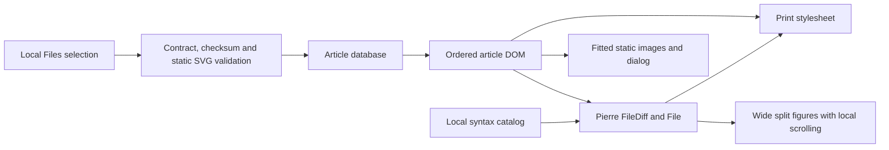

# Architecture

`src/import.ts` validates a complete folder using the generated portable contract
in `src/vendor/`. It verifies SHA-256, UTF-8 source, real line counts and byte
counts. `src/svg.ts` permits static SVG elements and attributes only, with no
scripts, links, external resources, embedded HTML, stylesheets or animation.

`src/storage.ts` owns IndexedDB repository snapshots and read markers. It starts
the replacement transaction only after all file validation completes. A repository
catalog is authoritative for that repository, never for other repositories.

`src/main.ts` owns selection and import feedback. `src/dom.ts` creates text-only
DOM elements. The static host serves the application, not private artifacts.
No runtime library calls a network API with imported content. A restrictive
Content Security Policy is defense in depth, not a substitute for safe rendering.

`src/reader.ts` renders a continuous article, contents, exact inline excerpts and
chapter progress. `src/diagrams.ts` owns image URLs, automatic layout selection and
the fitted modal dialog. `src/settings.ts` owns local theme and article text size.
The `raccoon-articles` IndexedDB database has no old workspace adapter or migration.
`src/code.ts` resolves explicit comparison endpoints and full-file context windows
through Pierre's vanilla components. `src/syntax.ts` owns the bounded offline
grammar/theme catalog; Vite aliases library catalog imports to it. Source parsing,
alignment, token escaping and rendering belong to the maintained dependencies.
Diagram dialogs fix the background body at its reading position on screens only;
close, Escape and disposal restore document scrolling. Print media keeps the body
in normal flow and overrides both light and dark screen color schemes.

<!-- mermaid-diagram: article-components -->

<!-- /mermaid-diagram: article-components -->

This component view is inspection-maintained. Browser integration tests check
literal content, import transactions, dialog fitting and print/offline behavior.

`scripts/build-worker.mjs` emits an offline worker from the production build's
static asset list. It never receives imported content. Navigation falls back to
the cached application shell when offline; local data is still owned by IndexedDB.

PR visual explanations are request-only. Explicitly requested learning diagrams
are product content, not default PR review illustrations.
